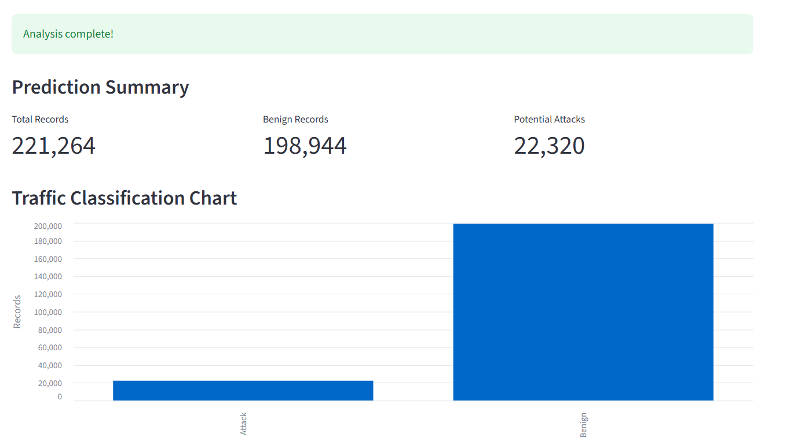

# NetAnomaly

### Machine Learning-Based Network Anomaly Detection System

NetAnomaly is an experimental machine learning project that classifies network-flow records as **Benign** or **Attack**. Using the CIC-IDS2017 dataset, it explores network intrusion detection, model evaluation, feature analysis, and the challenges of generalizing to traffic from different days and attack types.

> **Project status:** Experimental prototype. Models show strong performance on some random test splits but struggle to detect certain attacks in unseen-day evaluations. This project is not intended for production deployment.

## Project Objectives

- Build a machine learning pipeline for binary network traffic classification.
- Explore network-flow data and identify useful traffic features.
- Compare classification models and evaluation metrics.
- Investigate random-split performance versus unseen-day generalization.
- Understand the limitations of accuracy when attack classes are imbalanced.
- Build an interactive dashboard for uploading traffic data and reviewing predictions.

## Features

- Exploratory data analysis using pandas, NumPy, Matplotlib, and Seaborn.
- Binary classification: Benign (0) and Attack (1).
- Random Forest training and Logistic Regression comparison.
- Feature-importance and redundant-feature analysis.
- Evaluation using precision, recall, F1-score, and confusion matrices.
- Experimental classification-threshold analysis.
- Saved-model prediction and diagnostic scripts.
- Unseen-day evaluation using traffic from different CIC-IDS2017 days.
- Streamlit dashboard for CSV and Parquet uploads, predictions, visualizations, optional evaluation metrics, and downloadable results.

## Dataset

NetAnomaly uses the **CIC-IDS2017** network intrusion detection dataset.

Experiments include traffic from:

- **Tuesday:** Brute Force
- **Wednesday:** Denial of Service (DoS)
- **Thursday:** Infiltration
- **Friday:** Distributed Denial of Service (DDoS)

The original labels are mapped into two classes:

- `0` — Benign
- `1` — Attack

The dataset is not included in this repository. Obtain it from the [official Canadian Institute for Cybersecurity CIC-IDS2017 page](https://www.unb.ca/cic/datasets/ids-2017.html), prepare the required Parquet files, and place them in the local `data/` directory.

## Technology Stack

- **Language:** Python
- **Data processing:** pandas, NumPy
- **Machine learning:** scikit-learn
- **Model persistence:** joblib
- **Visualization:** Matplotlib, Seaborn, Streamlit
- **Data format:** Parquet via PyArrow
- **Development:** Jupyter Notebook

## Project Structure

```text
NetAnomaly/
├── data/                 # Local datasets; excluded from Git
├── models/               # Saved models; excluded from Git
├── notebooks/            # Exploratory data analysis
├── src/                  # Training, prediction, dashboard, and experiments
├── experiments.md        # Detailed experiment log
├── requirements.txt      # Python dependencies
├── README.md
└── .gitignore
```

## Setup

Python 3.11 or a compatible version is recommended.

### 1. Clone the repository

```bash
git clone https://github.com/sachitaaa/NETANOMALY.git
cd NETANOMALY
```

### 2. Create and activate a virtual environment

**Windows Command Prompt:**

```cmd
python -m venv .venv
.venv\Scripts\activate.bat
```

**Windows PowerShell:**

```powershell
python -m venv .venv
.\.venv\Scripts\Activate.ps1
```

### 3. Install dependencies

```bash
python -m pip install -r requirements.txt
```

### 4. Prepare the dataset and model

Place the required CIC-IDS2017 Parquet files in `data/` and the trained model at `models/random_forest.joblib`.

Dataset files and generated model artifacts are excluded from Git because of their size. You must prepare or obtain these files separately before running the prediction scripts or dashboard.

## Running the Project
### Dashboard Preview



### Launch the Streamlit dashboard

```bash
python -m streamlit run src/app.py
```

Open the local URL printed in the terminal, usually `http://localhost:8501`.

The dashboard accepts CSV and Parquet files, checks for required model features, generates predictions, displays a summary and chart, and allows the results to be downloaded as CSV. If a `Label` column is present, it also displays evaluation metrics by comparing the labels with the predictions.

### Train the baseline model

```bash
python src/train_model.py
```

### Run file-based predictions

```bash
python src/predict_file.py
```

When prompted, provide the path to a CSV or Parquet file containing the required model features.

### Run the diagnostic prediction script

```bash
python src/predict.py
```

This script evaluates a sample of Friday traffic and provides an interactive single-record prediction workflow.

### Run the unseen-day experiment

```bash
python src/experiment_unseen_day.py
```

Consult the script and `experiments.md` for the exact training and evaluation setup used by this experiment.

## Selected Experimental Findings

Experiments conducted during development produced the following results:

- A Random Forest achieved **99.90% accuracy** on one random test split using combined Tuesday and Wednesday traffic.
- In an experiment trained without Friday traffic, the model achieved **17.40% attack recall** when evaluated on Friday DDoS traffic.
- On a 10,000-record Friday sample, the baseline model achieved **16.76% attack recall**, missing 4,784 attack records under that experiment's prediction setup.
- In a Thursday Infiltration evaluation, a model trained on Tuesday, Wednesday, and Friday traffic failed to detect all 36 infiltration attack records at the default 0.50 threshold.
- Feature analysis showed substantial differences between the training attacks and Thursday's infiltration attacks.

These results come from different experiments and evaluation setups and should not be compared as though they came from one test set. The Thursday Infiltration evaluation contains only 36 attack records, limiting the conclusions that can be drawn about that attack type.

See [`experiments.md`](experiments.md) for the detailed experiment history and limitations.

## Limitations

- Generalization to traffic from unseen days and attack types remains a major challenge.
- High accuracy on random splits does not guarantee effective attack detection.
- The small number of Thursday Infiltration attack records limits the reliability of attack-specific conclusions.
- Some threshold and feature investigations are exploratory rather than independent final validation.
- The system has not been validated for live network deployment.
- Performance on CIC-IDS2017 does not establish effectiveness on real-world network traffic.

## Future Work

- Establish a reproducible training, validation, and final testing strategy.
- Strengthen feature-schema, data-type, and missing-value validation.
- Investigate generalization to additional attack types and independent datasets.
- Add automated tests and improve dependency management.
- Improve the dashboard's usability and add reproducible evaluation workflows.

## Learning Outcomes

This project explores data preprocessing, classification, model comparison, feature analysis, threshold evaluation, interactive application development, and the challenges of generalization under changing network traffic patterns.

> **Key takeaway:** Strong performance on familiar data does not guarantee reliable detection of previously unseen attacks.
